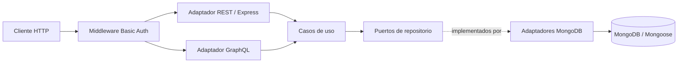

# API académica de ferretería

Proyecto para demostrar arquitectura hexagonal con Node.js, Express, MongoDB/Mongoose y GraphQL. El backend expone clientes, productos y ventas. REST y GraphQL comparten los mismos casos de uso.

## Requisitos y ejecución

- Node.js 20 o superior.
- MongoDB para ejecución normal; replica set o clúster compatible con transacciones para registrar ventas.
- Copiar `.env.example` a `.env`, completar MongoDB y credenciales.
- Ejecutar `npm ci`, luego `npm start` o `npm run dev`.
- Para Docker, construir desde `src` con `docker build -f src/Dockerfile -t ferreteria-api .`; inyectar variables de entorno al ejecutar el contenedor.

No usar credenciales de ejemplo fuera del entorno local. Basic Auth es didáctica; requiere HTTPS en tráfico remoto.

## Variables de entorno

| Variable | Uso |
| --- | --- |
| `PORT` | Puerto HTTP, predeterminado 3000. |
| `NODE_ENV` | Entorno mostrado en `/health`. |
| `MONGO_URI` | URI de MongoDB. |
| `BASIC_AUTH_USER`, `BASIC_AUTH_PASS` | Credenciales requeridas para iniciar el servidor y acceder a las APIs. |

## Endpoints REST

Todas las rutas `/api/*` y `/graphql` requieren `Authorization: Basic <base64(usuario:contraseña)>`. `/health` es público.

```http
GET/POST    /api/clientes
GET/PUT/DELETE /api/clientes/:id
GET/POST    /api/productos
GET/PUT/DELETE /api/productos/:id
GET          /api/productos/:id/disponibilidad?cantidad=2
GET/POST    /api/ventas
GET          /api/ventas/:id
```

Clientes requieren `nombre` y `documento`; pueden filtrarse por `nombre`, `documento` y `activo`. No se fuerza unicidad de documento, correo o teléfono porque no está especificada. DELETE desactiva al cliente.

Productos requieren SKU único, nombre, precio y stock entero no negativo. DELETE desactiva el producto. `precio` se envía como cadena decimal exacta en COP con máximo dos decimales, por ejemplo `"1299.50"`; se persiste como `Decimal128`. La disponibilidad se consulta por ID y cantidad requerida.

Ejemplo de registro de venta:

```bash
curl -u usuario:contraseña -H "Content-Type: application/json" \
  -d '{"clienteId":"ID_CLIENTE","detalles":[{"productoId":"ID_PRODUCTO","cantidad":2}]}' \
  http://localhost:3000/api/ventas
```

El servidor valida cliente/producto activos y existencias. Calcula importes; no acepta precios ni totales enviados. Cada detalle conserva SKU, nombre y precio aplicado. La venta y el descuento de inventario se confirman en una transacción para que no haya descuentos parciales. Se filtran ventas por `clienteId`, `desde` y `hasta` (fechas ISO).

## GraphQL

`/graphql` requiere Basic Auth. Incluye queries y mutations equivalentes para clientes, productos y ventas, llamando al mismo núcleo de aplicación que REST.

```bash
curl -u usuario:contraseña -H "Content-Type: application/json" \
  -d '{"query":"query { productos { sku nombre precio stock } }"}' \
  http://localhost:3000/graphql

curl -u usuario:contraseña -H "Content-Type: application/json" \
  -d '{"query":"mutation($input: VentaInput!) { registrarVenta(input:$input) { total detalles { sku cantidad subtotal } } }","variables":{"input":{"clienteId":"ID_CLIENTE","detalles":[{"productoId":"ID_PRODUCTO","cantidad":2}]}}}' \
  http://localhost:3000/graphql
```

## Arquitectura



- **Dominio:** reglas de importe y errores de negocio; no importa Express, GraphQL ni Mongoose.
- **Aplicación:** casos de uso de clientes, productos y ventas; dependen de contratos de repositorio.
- **Infraestructura:** adaptadores Mongoose que implementan esos contratos y manejan transacciones.
- **Adaptadores HTTP:** autenticación, rutas REST, esquema/resolvers GraphQL y formato de errores.
- **Composition root:** `server.js` conecta Mongo, crea adaptadores/casos de uso y configura Express.

Estructura principal: `src/domain` contiene reglas y errores; `src/application` contiene casos de uso y puertos; `src/infra/db` contiene modelos/adaptadores Mongoose; `src/adapters` contiene HTTP, GraphQL, controladores y middlewares; `test` contiene pruebas.

El flujo de cada transporte autentica la petición, llama al mismo caso de uso y serializa su resultado. Autenticación comprueba credenciales; el backend no implementa autorización por roles. Las reglas de negocio verifican condiciones como stock suficiente y cliente activo. REST informa 400, 404, 409 o 500 según corresponda; GraphQL expone códigos de error en `errors[].extensions`. Los errores internos no devuelven detalles sensibles.

Helmet configura cabeceras, CORS permite acceso del cliente web, Morgan registra método/estado/tiempo, `express.json()` limita cuerpos a 1 MB, Basic Auth protege las APIs y el manejador global normaliza errores. Las credenciales no se escriben en los logs.

Patrones usados: Ports and Adapters, inyección de dependencias en el composition root, repositorios y value object `Amount` con aritmética decimal exacta. Las operaciones REST/GraphQL no duplican las reglas.

## Pruebas

```bash
npm test
npm run lint
```

Las 9 pruebas unitarias y de HTTP usan repositorios en memoria: comprueban CRUD, validaciones de precio/cantidad, Basic Auth en REST y GraphQL, serialización Mongoose, snapshots y rollback del unit of work de ventas. No se ejecutaron pruebas de integración MongoDB; para ventas hace falta una instancia replica set.

## Diagnóstico, decisiones y límites

El diagnóstico del estado inicial está en [docs/diagnostico.md](docs/diagnostico.md). El repositorio solo tenía CRUD de piezas, acoplamiento directo a Mongoose y rutas montadas dos veces. El módulo heredado de piezas se retiró del código y la API; la colección `piezas` y sus datos existentes en Atlas no se eliminan.

| Inicial | Refactorizado |
| --- | --- |
| Casos de uso instanciaban Mongoose repository. | Casos de uso dependen de puertos e inyección. |
| Controladores devolvían 400 para cualquier error. | Validación, ausencia, conflicto e internos se clasifican por separado. |
| CRUD de piezas y REST. | Clientes, productos y ventas por REST y GraphQL compartiendo casos de uso. |
| Sin pruebas ni guía arquitectónica. | Pruebas en memoria, documentación y guion académico. |

El SKU de producto es único; en clientes no se inventó una clave única. Precios de producto y ventas usan COP con máximo dos decimales y `Decimal128` en Mongo. Las transacciones de ventas requieren replica set. Basic Auth es un mecanismo académico, no un sistema de identidad. Persisten JWT y dependencias anteriores sin uso que se deben revisar antes de retirar.

La instalación inicial reportó alertas. Se quitaron dependencias indirectas vulnerables actualizables, reemplazando nodemon por `node --watch`, y se aplicaron actualizaciones compatibles. `npm audit` final informó cero vulnerabilidades.

## Guion de demostración

1. Seguir una petición REST y otra GraphQL hasta el mismo caso de uso.
2. Mostrar el puerto de repositorio y la implementación Mongo detrás del contrato.
3. Explicar Basic Auth y diferenciar autenticación de reglas de negocio.
4. Ejecutar `npm test` y mostrar el repositorio en memoria como sustituto de Mongo.
5. En Mongo replica set, registrar una venta y revisar snapshots y descuento transaccional.
6. Explicar cómo cambiar transporte o persistencia sin reescribir las reglas.

El frontend React + Vite queda para una fase posterior a la verificación de integración del backend. Incluirá un selector REST/GraphQL en la capa de comunicación.
